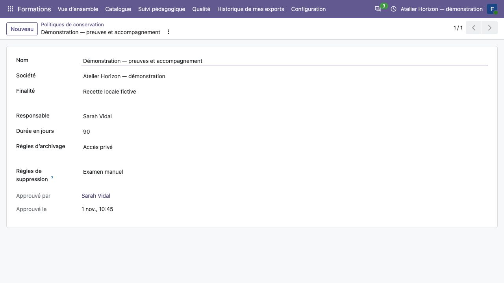

Administrer Training Management
===============================

Ce chapitre concerne l'administrateur de l'application. Les interventions sur
le serveur, sauvegardes d'exploitation et changements de production relèvent
du dossier d'exploitation de chaque organisme.

Choisir les modules
-------------------

L'administrateur technique rend les addons disponibles dans Odoo, puis utilise
**Applications** pour installer les modules nécessaires sur une base préparée.
Faire vérifier la compatibilité avec la distribution exacte utilisée avant
toute installation ou mise à jour.

.. list-table::
   :header-rows: 1

   * - Module
     - Fonctions
   * - ``training_management``
     - Catalogue, organisation, portail, supports, activités, présences, qualité, attestations et suivi.
   * - ``training_management_sale``
     - Intégration CRM et Ventes, demandes de devis et liens contractuels.
   * - ``training_management_survey``
     - Examens blancs, questionnaires en ligne et diagnostic d'orientation.
   * - ``training_management_website``
     - Intégration du menu catalogue à Website ; installation automatique lorsque le socle et Website sont présents.
   * - ``sale_invoice_address_fiscal``
     - Option fiscale indépendante. Ce n'est pas une dépendance de Training Management.

Website et eLearning ne sont pas requis pour utiliser le portail de formation.
L'intégration Surveys réutilise les questionnaires natifs sans assimiler les
examens blancs à la certification Odoo.

Configurer sociétés et comptes
------------------------------

#. Dans :menuselection:`Paramètres --> Utilisateurs & Sociétés`, vérifier les
   sociétés exploitantes, leurs informations et les sociétés autorisées des utilisateurs.
#. Préparer les contacts Odoo de l'organisme, des clients, participants et
   intervenants. Réutiliser les contacts existants après contrôle d'identité.
#. Inviter les personnes extérieures avec un compte portail personnel selon
   le mécanisme Odoo. Ne pas créer un second système d'authentification.
#. Attribuer aux utilisateurs internes les groupes strictement nécessaires.
#. Faire les affectations métier : inscription et compte participant, mission
   formateur/tuteur, habilitation client, responsabilité qualité ou supervision.
#. Vérifier chaque profil avec un compte restreint avant de l'utiliser réellement.

Un compte désactivé ne peut plus bénéficier des accès pédagogiques. Modifier
le rattachement employeur d'un contact ne transfère pas ses dossiers ou résultats.
Pour les mots de passe, utiliser la procédure native Odoo depuis la fiche
utilisateur ; ne pas conserver de mots de passe dans les documents du module.

Attribuer les droits
--------------------

.. list-table:: Groupes et affectations
   :header-rows: 1
   :widths: 30 70

   * - Profil
     - Autorité et limite principale
   * - Lecteur du catalogue
     - Lecture du catalogue ; aucun droit d'administration des inscriptions.
   * - Coordinateur des formations
     - Gestion de l'organisation dans ses sociétés ; ne donne pas les droits Ventes ni la lecture générale des travaux privés.
   * - Responsable qualité des formations
     - Rôle qualité, complété par les affectations propres aux dossiers ; aucun pouvoir global de coordination.
   * - Superviseur de formation
     - Consultation des réalisations affectées ; aucune validation pédagogique ou qualité par le seul rôle.
   * - Modérateur des publications de formation
     - Décisions de publication des avis et cas clients dans son périmètre.
   * - Commercial / facturation
     - Groupes natifs CRM, Ventes ou comptabilité selon le besoin. Le commercial seul consulte certains états organisationnels, sans les modifier.
   * - Participant, formateur, tuteur, représentant
     - Compte personnel et affectation précise ; le groupe portail ne donne aucun accès général aux dossiers.

Pour un coordinateur qui édite les examens blancs, ajouter le rôle natif
**Sondages / Utilisateur** nécessaire à l'éditeur. Ce rôle seul ne donne pas
accès aux examens de formation.

Lors d'un départ ou changement de fonction, retirer les affectations et
habilitations concernées, puis contrôler les anciens liens. Archiver le compte
si la personne ne doit plus utiliser Odoo. Les historiques et documents émis
restent conservés selon leur politique.

   Exemple synthétique de politique approuvée : les 90 jours affichés sont une
   donnée de démonstration et ne constituent pas une recommandation de durée.

Paramétrer conservation et notifications
----------------------------------------

#. Faire approuver par la qualité les **Politiques de conservation** : finalité,
   responsable, durée, archivage, traitement des suppressions et gels éventuels.
#. Associer la politique adaptée aux dossiers, projets, actions ou collectes
   qui l'exigent. Une politique fictive de recette ne vaut pas approbation métier.
#. Régler les paramètres de notification de la société, les échéances et les
   intervalles utiles. Pour les alertes de dates, sélectionner une politique approuvée.
#. Contrôler modèles, destinataires et file de courriels sur un environnement de
   recette. La configuration d'une politique n'active pas le transport des courriels.
#. Faire activer le transport réel selon les procédures d'exploitation de l'organisme.

Les notifications pédagogiques sont individuelles, génériques et conduisent à
un espace authentifié. Ne pas placer des résultats, corrigés, preuves ou pièces
sensibles dans le contenu des courriels ou le chatter général d'une réalisation.
Une erreur de courriel ne signifie pas que l'opération métier a échoué.

.. important::
   Le module n'impose ni devises ni méthode d'encaissement. Listes de prix,
   taxes, localisations, paiements et rapprochements relèvent du standard Odoo
   et des extensions installées. Voir :doc:`commercial`.

Préparer une reprise ou une mise à jour
---------------------------------------

Confier la reprise Odoo 19 à un responsable identifié. Définir les données à
reprendre, les correspondances, les contrôles de volumes et les échantillons
à valider. Les données historiques non qualifiées restent des archives :
aucune équivalence pédagogique ou habilitation n'en est déduite automatiquement.
Tester installation et mise à jour sur une base isolée ; une migration de
production nécessite sa décision et ses contrôles propres.

**Contrôle de fin de paramétrage :** un participant ne voit que son inscription,
un client seulement ses lots autorisés, un formateur ses missions, et un
responsable qualité ses dossiers affectés. Vérifier ces limites aussi sur les
téléchargements, les exports et les liens déjà reçus.
