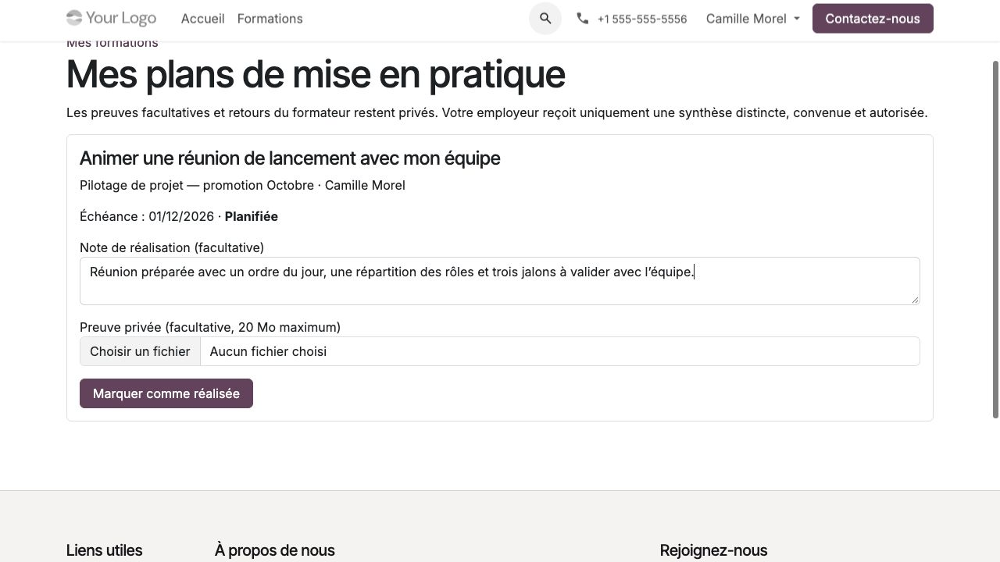

Accompagner après la formation et publier un avis
=================================================

Plans de mise en pratique
-------------------------

La coordination constate la fin de formation sur une réalisation effectuée,
avant sa clôture administrative. Dans **Suivi pédagogique → Plans de mise
en pratique**, elle crée les objectifs convenus à 30 ou 60 jours : référence
de prestation, retour du tuteur inclus ou non et politique de conservation approuvée.
Une action à chaque horizon est possible ; rien n'est créé automatiquement.

L'échéance utilise la date civile de fin constatée et le fuseau de la réalisation.
La définition est conservée : pour corriger une action, la fermer puis la remplacer.

#. Le participant ouvre **Mes plans de mise en pratique** depuis son portail.
#. Il consulte l'objectif et l'échéance, puis marque l'action réalisée, avec
   note et fichier facultatifs de **20 Mo maximum**.
#. Le tuteur actuellement affecté peut ajouter un retour après réalisation et
   avant clôture si la prestation l'inclut.
#. La coordination clôture ; elle peut également clore une action encore prévue.

Le circuit est prévue → réalisée → clôturée. La réalisation arrête les rappels,
sans attendre l'avis du tuteur. Le rappel à échéance, puis son intervalle,
dépendent du paramétrage ; zéro désactive l'intervalle. Aucun rattrapage ancien
n'est créé à la mise à jour. Les courriels ne contiennent pas l'objectif ou les preuves privées.

Une expiration des supports ou clôture administrative normale ne supprime pas
ce suivi. Une suspension, révocation, annulation, désactivation du compte ou
retrait explicite des accès concernés peut le bloquer ; clôturer ne réactive
pas une suspension antérieure. La coordination peut utiliser **Retirer les
accès de mise en pratique** pour retirer ce suivi, y compris après clôture normale.

La synthèse destinée au commanditaire est saisie séparément avec son accord,
sa conservation et l'habilitation client pertinente. Publier fige ce texte.
Aucun travail, objectif privé ou retour de tuteur n'y est copié automatiquement.

   Le participant prépare sa note avant de marquer l'action réalisée. La saisie
   visible n'est pas encore une confirmation d'enregistrement.

Rédiger un avis vérifié
-----------------------

Le coordinateur peut inviter un participant dont la présence S07 actuellement
validée est strictement positive. Une inscription seule, une réservation de
tutorat ou un score d'examen ne suffit pas. Le eLearning sans présence S07
ne reçoit pas un critère de participation inventé.

#. Ouvrir la demande dans **Demandes de publication** avec son compte personnel.
#. Rédiger le texte et relire son contexte public exact.
#. Choisir **Participant vérifié** ou le nom exact prévisualisé. L'utilisation
   du nom nécessite un accord distinct.
#. Donner l'accord explicite sur le texte final et le contexte, puis transmettre.
#. Consulter le statut. Le modérateur prend une décision motivée ; aucun
   avis n'est publié par la seule transmission.
#. Retirer son accord depuis le parcours prévu si l'avis ne doit plus être visible.

Les avis sont facultatifs et sans avantage conditionné à la réponse. Le
modérateur ne réécrit pas silencieusement un texte consenti : une modification
nécessite un nouvel accord. Le nom, employeur, photo ou avatar ne sont pas
récupérés automatiquement. Vérifier que le texte ne révèle pas l'identité d'un tiers.

Modérer un avis ou un cas client
--------------------------------

Le **Modérateur des publications de formation** ouvre **Qualité → Avis et cas
clients**, vérifie participation, consentement, identité autorisée et contexte,
puis motive sa publication ou son refus. Le rôle de coordination seul ne donne
pas le pouvoir de publier.

Un cas client utilise un texte public distinct du dossier privé. L'autorisation
du représentant doit viser cette version exacte ; le nom d'entreprise exige
une autorisation distincte. Le premier périmètre n'inclut pas les logos,
citations nominatives ou résultats individuels.

Le retrait masque immédiatement la projection publique tout en conservant
la preuve privée. Il ne supprime pas les copies faites par des tiers. Une
demande de suppression de données reste une instruction distincte auprès
du responsable désigné, avec contrôle de la conservation et des gels.
