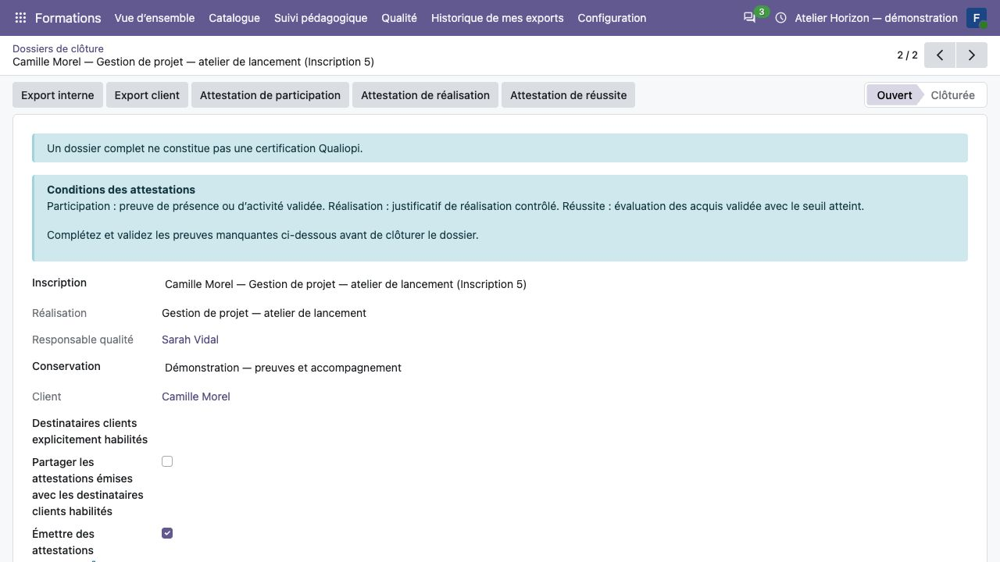
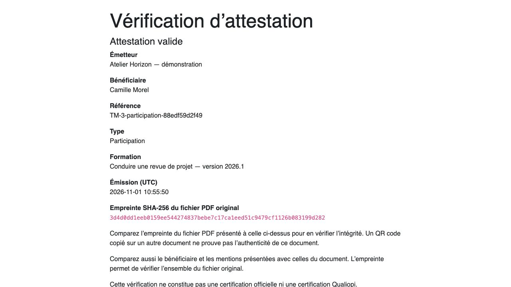

Constituer le dossier, délivrer et vérifier les attestations
============================================================

**Profils :** coordination pour la préparation ; responsable qualité
explicitement affecté pour les décisions et la délivrance.

Préparer le dossier et les preuves
----------------------------------

#. Faire approuver une politique de conservation par la qualité.
#. Depuis l'inscription, ouvrir **Dossier de clôture**, choisir le responsable
   qualité et cette politique. Le dossier conserve le client d'origine.
#. Ajouter les PDF de preuve avec catégorie, auteur original, date de
   production, source et référence d'origine.
#. La qualité contrôle chaque pièce et valide la version, ou motive une
   non-applicabilité ou dérogation lorsque le circuit la permet.
#. Contrôler les manquants avant de clôturer le dossier.

Chaque ajout dans une catégorie crée une version liée à la précédente. Une
version validée ne se réécrit pas. Une nouvelle version en attente rend sa
catégorie manquante jusqu'à sa validation. Une dérogation documentaire ne
remplace pas les critères de délivrance d'une attestation.

   Préparer les responsabilités et contrôler les pièces du dossier.

Choisir le bon document
-----------------------

.. list-table:: Conditions de délivrance
   :header-rows: 1
   :widths: 25 75

   * - Attestation
     - Conditions à contrôler
   * - Participation
     - Durée issue des présences S07 retenues et validées strictement positive, y compris après abandon. Une déclaration seule ne suffit pas.
   * - Réalisation
     - Activités obligatoires complètes et justificatif de réalisation contrôlé.
   * - Réussite
     - Évaluation dédiée d'acquis notée, preuve PDF validée, score et seuil validés et seuil atteint.

Le responsable qualité affecté délivre le type correspondant depuis le dossier
de l'inscription confirmée ou terminée. Vérifier bénéficiaire, programme/version,
dates, référence et critères avant partage. Un examen blanc réussi ne remplace
pas l'évaluation dédiée et ne déclenche aucune attestation automatique.

Les PDF conservent les critères à l'émission. Répéter une émission identique
retrouve le même PDF. Corriger une présence ou une évaluation ne réécrit pas
un ancien document : une nouvelle émission conserve les anciens fichiers.
Les dates imprimées sur ces documents sont en UTC.

Partager, exporter et clôturer
------------------------------

Le participant et les contacts clients ne reçoivent que les fichiers autorisés
dans **Mes documents de formation**. Pour le client, choisir explicitement
les destinataires dans le client du dossier et les pièces partageables.
Le partage des attestations doit être choisi avant émission.

L'export qualité conserve les preuves validées, leurs versions et un index
de provenance et d'empreintes. Un dossier incomplet peut être exporté et
l'index le signale. L'export client est limité aux catégories et destinataires
autorisés ; il exclut notamment évaluations individuelles, positionnements,
retours, incidents et contrôles privés, y compris leurs métadonnées.

Pour clôturer, toutes les dernières versions requises doivent être validées,
avec les décisions de dérogation applicables conservées. Un dossier clos garde
son historique. Pour une rectification, utiliser la réouverture motivée et,
si nécessaire, la réaffectation du responsable qualité, puis clôturer à nouveau.
Un gel de conservation est indépendant de l'état du dossier. Aucune purge
automatique n'intervient à l'échéance de conservation.

Émettre une attestation vérifiable
----------------------------------

#. La coordination coche **Émettre des attestations vérifiables** dans le dossier.
#. La qualité délivre selon les conditions habituelles du type choisi.
#. Contrôler le nouveau PDF, son lien et son QR code.
#. Informer le bénéficiaire que toute personne possédant ce lien verra notamment
   son **nom complet**, l'émetteur, la formation/version, référence, type,
   date d'émission, statut et empreinte SHA-256.

L'option ne publie pas rétroactivement les anciens PDF. La page publique
n'expose ni fichier PDF, ni score, seuil, résultat d'examen, dossier ou motif de
révocation. La connaissance du lien permet de consulter cette projection limitée.

Vérifier, révoquer ou remplacer
-------------------------------

Le destinataire ouvre le lien ou scanne le QR et lit **valide**, **révoquée**,
**remplacée** ou **inconnue**. Une attestation inconnue ne confirme pas le document.
Pour vérifier le fichier complet, comparer son empreinte SHA-256 avec celle
affichée : recopier un QR sur un autre fichier n'en prouve pas l'intégrité.

   Projection publique limitée d'une attestation de démonstration émise le
   1 novembre 2026. Aucun PDF ou score n'est servi par cette page.

Le responsable qualité affecté peut révoquer ou remplacer avec motif, même
après clôture. Pour remplacer, corriger les critères, émettre préalablement une
attestation vérifiable valide du même type et dossier, puis désigner ce
remplacement. Ces décisions sont définitives et ne réécrivent aucun PDF.
Réémettre les mêmes critères ne réactive pas une attestation révoquée.

La page de l'ancien document n'expose pas le lien du nouveau : transmettre
le nouveau document au destinataire autorisé par le circuit habituel.
Ces attestations et leur vérification ne constituent ni certification officielle
ni certification Qualiopi.
