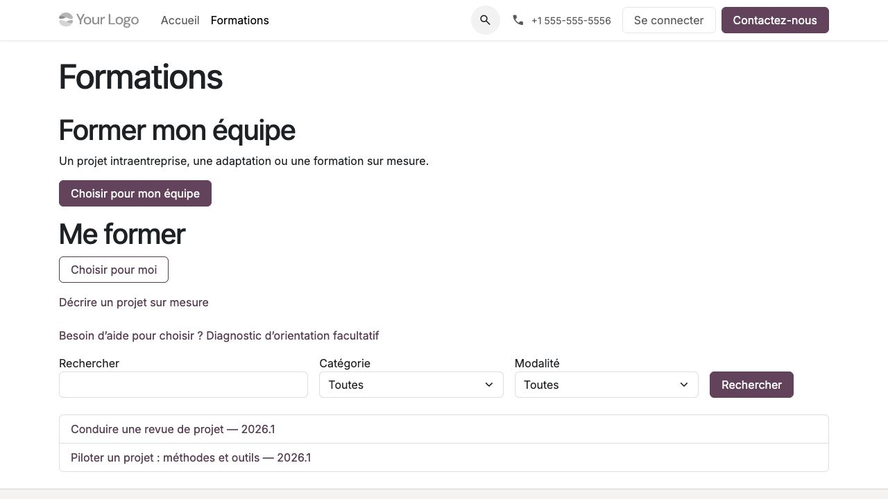

Choisir une formation et demander conseil
=========================================

**Profils :** visiteur, futur participant ou représentant d'entreprise.
Le catalogue se trouve à l'adresse ``/formations`` de l'organisme. La consultation
du catalogue et la demande commerciale ne nécessitent pas de compte apprenant.

Trouver une formation
---------------------

#. Choisir **Former mon équipe** ou **Me former**. Pour un besoin particulier,
   utiliser **Décrire un projet sur mesure**.
#. Rechercher par texte et filtrer par catégorie ou modalité.
#. Ouvrir la fiche et lire objectifs, public, prérequis, durée, modalités,
   inclusions, exercices et préparation attendue.
#. Télécharger le programme public. Si un aperçu est disponible, consulter
   l'extrait ou répondre au mini-quiz de démonstration.
#. Utiliser **Demander un devis pour mon équipe** ou **Demander un devis individuel**.
   Le parcours et la version choisie sont repris dans le formulaire.

La démonstration donne une correction sans créer d'inscription, de tentative
d'examen ou de progression. Un examen blanc et un examen officiel sont deux
prestations différentes : vérifier les inclusions indiquées sur la fiche et le devis.

   Choix du parcours et filtres du catalogue, démonstration du 1 novembre 2026.

Envoyer une demande
-------------------

#. Préciser s'il s'agit du catalogue, d'une adaptation ou d'une création sur mesure.
#. Décrire objectifs, niveau, effectif, pays, dates souhaitées ou à discuter,
   modalité, outils et besoin éventuel de conseil.
#. Renseigner les coordonnées demandées ; vérifier la langue et la devise indicative.
   Le devis utilisera ensuite la devise de sa liste de prix native.
#. Joindre si nécessaire un PDF privé, de **10 Mo maximum**.
#. Envoyer, puis lire la confirmation de réception. L'organisme qualifie ensuite
   la demande avant toute proposition contractuelle.

En cas d'erreur, les textes sont conservés ; sélectionner de nouveau le fichier
si le navigateur le demande. Une répétition identique du même formulaire retrouve
la demande initiale. Pour un nouveau contenu après envoi, suivre l'indication
de l'écran et ouvrir un nouveau formulaire.

Une demande ne crée pas automatiquement de compte, devis, inscription ou droit
pédagogique. Le nom d'entreprise et le domaine de courriel ne donnent aucun
accès aux dossiers de cette entreprise.

Utiliser le diagnostic d'orientation
------------------------------------

Le diagnostic est facultatif et disponible seulement si l'organisme l'a publié.
Il reste possible de consulter directement le catalogue ou de demander un conseil humain.

#. Depuis le catalogue, ouvrir **Diagnostic d'orientation facultatif**.
#. Répondre à toutes les questions à choix unique.
#. Lire la recommandation, son explication et les réponses déterminantes.
#. Si aucun profil unique ne correspond, demander conseil ; aucun classement
   arbitraire n'est proposé. Recommencer si nécessaire.

Les réponses et le résultat ne sont pas conservés dans le dossier commercial
ou pédagogique. Le diagnostic ne vaut ni admission, ni positionnement pédagogique,
ni validation des prérequis, ni promesse de résultat.

Consulter les dates et gérer ses alertes
----------------------------------------

Les dates visibles sont explicitement publiées par l'organisme. Les statuts
**Ouverte**, **Confirmée** ou **Complète** tiennent compte de la disponibilité.
Le **départ garanti** est un engagement explicite distinct ; une session confirmée
n'est pas automatiquement garantie.

#. Ouvrir la fiche d'une formation et ses dates publiques.
#. Pour recevoir les prochaines dates, se connecter avec un compte Odoo existant.
#. Lire les conditions et la politique de conservation, puis donner l'accord
   volontaire demandé. Aucune case ne doit être présumée cochée.
#. Gérer le retrait dans **Mes alertes de dates**, à l'adresse
   ``/my/training-date-alerts``. **Me réabonner** nécessite un nouvel accord.

Une première publication future postérieure à l'abonnement peut produire une
alerte par réalisation. Modifier ou republier les mêmes dates ne crée pas une
nouvelle alerte ; un réabonnement ne rejoue pas les anciennes publications.
Un employeur ne peut pas abonner ses salariés à leur place.
