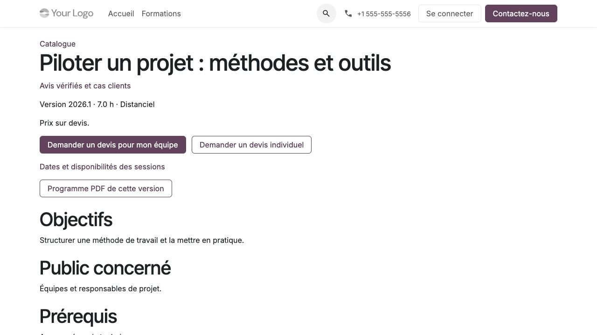

Gérer le catalogue et les programmes
====================================

**Profil :** coordinateur. Le lecteur consulte le catalogue sans le modifier.
Le catalogue pédagogique reste distinct des produits utilisés dans Ventes.

Créer une formation et sa version
---------------------------------

#. Ouvrir :menuselection:`Formations --> Catalogue --> Formations standards`,
   puis **Nouveau**.
#. Identifier la formation et sa catégorie. Les catégories se gèrent dans
   :menuselection:`Formations --> Configuration --> Catégories de formation`.
#. Préparer une version dans **Versions de programme** : objectifs, public,
   prérequis, contenu, durée, modalités et moyens pédagogiques.
#. Renseigner les informations destinées au choix : résultats attendus,
   exercices/livrables, durée d'accès, inclusions, préparation et statut de
   l'examen officiel lorsqu'il existe.
#. Vérifier les contenus, puis valider la version. Contrôler le PDF du programme
   et sa référence avant de l'utiliser commercialement ou pédagogiquement.

Une version validée est figée. Ne pas essayer de corriger un programme déjà
utilisé en modifiant son fichier ou son texte : créer une nouvelle version,
effectuer le contrôle puis la valider. Les réalisations et contrats existants
gardent leurs références d'origine.

Publier une fiche publique
--------------------------

#. Sur le brouillon, compléter les rubriques publiques et approuver explicitement
   leur diffusion. Préparer, si souhaité, un extrait PDF public distinct des supports privés.
#. Ajouter les questions de démonstration facultatives. Elles ne reprennent pas
   une banque d'examen privée.
#. Valider puis publier la version selon les actions de la fiche.
#. Ouvrir le catalogue public sans connexion ; contrôler recherche, catégorie,
   modalité, fiche, PDF du programme et extrait.
#. Retirer la publication lorsque la fiche ne doit plus être proposée.

Une information manquante peut apparaître comme non confirmée. Cela ne vaut pas
promesse commerciale. Après validation, tout enrichissement du programme exige
une nouvelle version et les approbations correspondantes.

.. important::
   Un PDF public est une décision de diffusion. Ne pas y placer un cas client
   confidentiel, une adaptation individuelle, un lien de salle distante ou
   un support pédagogique réservé. Le retrait empêche les nouvelles lectures
   publiques ; il ne rappelle pas les fichiers déjà téléchargés.

   Contrôler en visiteur les informations réellement publiées.

Gérer une adaptation intraentreprise
------------------------------------

Une **version intra client** appartient à une réalisation dédiée à une seule
entité cliente. Elle conserve le programme standard source et décrit les
objectifs client, cas métiers et consignes adaptés. Son PDF éventuel reste privé.

#. Créer la version client et vérifier réalisation, client et programme source.
#. Soumettre le contenu : il devient figé pour l'accord.
#. Faire enregistrer l'accord par le représentant habilité dans son portail,
   ou consigner un accord externe avec le contact et sa référence justificative.
#. Confirmer le contenu, puis confirmer la réalisation selon le circuit d'organisation.
#. Pour corriger, créer une version suivante et demander un nouvel accord.

L'ancienne version confirmée reste applicable jusqu'à confirmation de la suivante.
L'accord est une trace métier sur une version précise ; il ne revendique pas
une signature qualifiée. Voir le parcours du client dans :doc:`entreprise`.

Préparer un parcours de plusieurs formations
--------------------------------------------

#. Ouvrir :menuselection:`Formations --> Catalogue --> Parcours de formation`.
#. Ajouter une version standard par formation, dans des positions distinctes.
#. Choisir un ordre conseillé ou obligatoire ; ajouter les prérequis explicites
   vers les étapes antérieures et vérifier la durée totale.
#. Valider pour figer la composition. Une évolution se prépare par duplication
   en brouillon, puis nouvelle validation.
#. Dans **Rattachements aux parcours**, relier chaque étape à une inscription
   existante du participant. Documenter et valider toute équivalence de programme.

Un rattachement ne crée pas une nouvelle place ni un nouvel accès. L'équivalence
est individuelle et motivée. Une étape est complète lorsque ses activités
obligatoires le sont et que l'inscription est confirmée ou clôturée : la clôture
administrative seule et l'absence d'activités ne prouvent pas la complétion.

L'ordre obligatoire exige les étapes précédentes ; les prérequis explicites
s'appliquent aussi à l'ordre conseillé. Les contraintes se cumulent si une
inscription participe à plusieurs parcours. Un rattachement erroné se retire
avec motif ; sa trace reste conservée. Voir :doc:`pedagogie` pour l'effet sur
l'accès et :doc:`commercial` pour la vente complète ou partielle.
