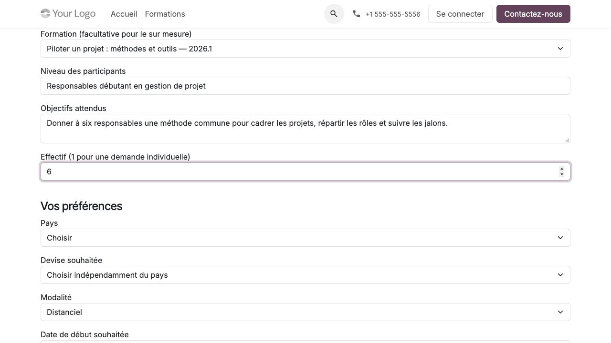

Traiter les demandes, devis et factures
=======================================

**Profils :** commercial et facturation, avec les groupes natifs nécessaires.
Ce chapitre suppose l'intégration ``training_management_sale`` installée.
La coordination conserve la décision d'admission et d'ouverture des accès.

Qualifier une demande
---------------------

#. Dans CRM, ouvrir la demande reçue depuis le catalogue ou enregistrer la demande
   recueillie directement auprès du client.
#. Vérifier l'intention individuelle ou équipe, les objectifs, l'effectif,
   la modalité, les dates, le pays et le besoin de conseil.
#. Identifier les contacts et l'entité commerciale cliente dans les contacts
   Odoo existants ; ne pas déduire une habilitation d'un nom ou domaine de courriel.
#. Retenir un programme validé. Pour le sur mesure, préparer et valider ce programme
   avant de produire le devis.
#. Définir explicitement les contacts autorisés à recevoir les documents commerciaux.

Les pièces de la demande CRM restent internes aux lecteurs CRM autorisés. Un
représentant d'entreprise ne reçoit pas automatiquement la pièce jointe d'une demande.
Un avis de virement privé éventuel reste une information sans effet comptable.

   Les objectifs et l'effectif saisis dans la demande doivent être qualifiés avant devis.

Établir et confirmer une offre
------------------------------

#. Créer le devis natif et choisir client, adresses, liste de prix et conditions.
#. Relier la prestation à la version pédagogique applicable et vérifier les
   quantités : tarif par personne ou forfait et effectif contractuel explicite.
#. Contrôler prix, remises, taxes, devise et échéances selon la configuration
   native et les éventuelles extensions de l'organisme.
#. Relire le programme/version et le périmètre proposé ; transmettre seulement
   aux contacts nommément habilités.
#. Confirmer selon le circuit Ventes habituel après acceptation du client.
#. Transmettre à la coordination les éléments nécessaires aux lots et inscriptions.

La devise demandée est indicative ; l'offre utilise celle de la liste de prix.
Changer la devise d'une liste ne recalcule pas à lui seul celle déjà stockée sur
une commande. Les contrôles financiers restent ceux d'Odoo et des extensions
installées, tandis que les références pédagogiques contractuelles sont conservées.

.. important::
   Ni la confirmation d'une commande, ni un paiement, ni un droit de lecture
   sur un devis ne confirment l'admission et n'ouvrent l'espace pédagogique.
   Le paiement différé B2B peut être autorisé explicitement par la coordination.

Vendre un parcours complet ou partiel
-------------------------------------

Le parcours réutilise les produits et prix des formations qui le composent ; il
n'introduit pas un produit commercial indépendant. Choisir les étapes vendues,
documenter les acquis retenus et conserver la composition acceptée. Une
équivalence pédagogique doit rester explicite et validée : ne pas la déduire
d'une remise, d'un ancien devis ou d'une archive non qualifiée.

Le participant peut avoir des étapes déjà acquises et des étapes encore à suivre.
Les inscriptions et leurs droits restent uniques ; la coordination les rattache
au parcours selon :doc:`catalogue` et :doc:`pedagogie`.

Facturer et suivre les règlements
---------------------------------

#. Créer la facture depuis le circuit natif de la vente selon la politique de facturation.
#. Vérifier les adresses, taxes, devise, montants et destinataires autorisés.
#. Comptabiliser et enregistrer les paiements selon les droits et outils natifs.
#. Utiliser les rapprochements, avoirs et contrôles de résiduels natifs pour les
   règlements partiels, écarts ou remboursements.
#. Traiter séparément les conséquences sur les places et accès avec la coordination.

Le module ne limite pas les devises à MAD/EUR et n'impose pas le virement.
Les liens, QR et transactions de paiement natifs peuvent exister selon les
prestataires installés ; Training Management n'en active aucun automatiquement.
Le jeton d'un document ne remplace pas l'habilitation documentaire actuelle.

Un reçu portant plusieurs factures reste soumis au périmètre commun autorisé.
Le rattachement à un employeur, le statut de payeur ou un transfert de lien ne
donne pas accès aux pièces commerciales d'un autre contact.

Annuler ou modifier une prestation
----------------------------------

Faire traiter les lots et inscriptions encore vivants avant l'annulation d'une
commande qui les engage. Une libération de place ne crée pas automatiquement
d'avoir et ne modifie pas le paiement. Inversement, un avoir ne doit pas être
interprété comme une décision pédagogique de report ou de révocation.
La procédure métier est décrite dans :doc:`organisation`.

**Contrôle final :** rapprocher programme/version, effectif contractuel, lots
engagés, documents partagés et état financier. Les détails pédagogiques privés,
notes et corrigés ne sont pas des informations commerciales à transmettre.
