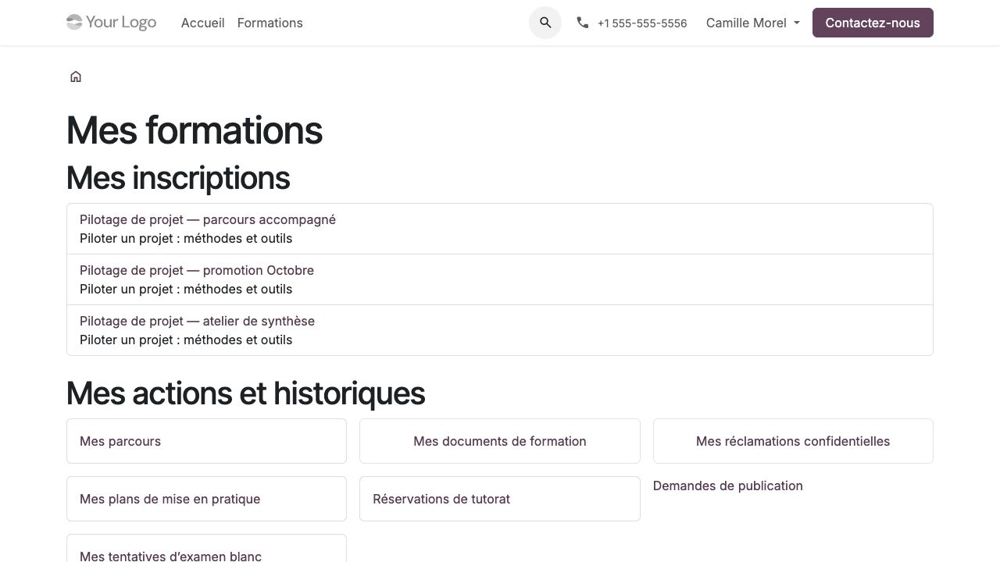

Prendre en main l'application
=============================

Comprendre les objets
---------------------

Une **formation standard** représente une offre du catalogue. Sa **version de
programme** décrit les objectifs, prérequis, modalités et contenu applicable.
Une version validée reste conservée ; une évolution crée une nouvelle version.

Une **formation organisée**, appelée aussi réalisation, met ce programme en
œuvre pour une session datée ou une offre autonome. Les **séances** sont ses
créneaux de planning. Une offre autonome n'a pas besoin de séances fictives.

Un **lot de places** réserve une quantité pour un client. Une **inscription**
identifie une personne dans une réalisation. Un **parcours de formation** relie
plusieurs formations : il réutilise les inscriptions existantes, leurs activités
et leurs droits.

.. admonition:: Exemple

   Une entreprise achète un lot de dix places et propose sept personnes. Le lot
   occupe dix places dans la capacité ; trois restent à nommer. Les sept
   inscriptions ne portent pas la capacité occupée à dix-sept.

Distinguer les décisions
------------------------

Le circuit commercial, l'admission, les droits pédagogiques et la clôture sont
des décisions distinctes. Un devis accepté ou un paiement enregistré ne donne
pas automatiquement accès aux supports. Une attestation n'est pas créée parce
qu'un examen blanc est réussi.

.. list-table:: Repères du flux global
   :header-rows: 1

   * - Étape
     - Responsable habituel et résultat attendu
   * - Préparer et publier
     - Le coordinateur valide une version de programme et choisit sa diffusion publique.
   * - Contractualiser
     - Le commercial qualifie la demande, prépare l'offre et confirme la commande selon le circuit natif.
   * - Organiser et admettre
     - Le coordinateur planifie, réserve les places, confirme les personnes et décide des accès.
   * - Apprendre et accompagner
     - Le participant réalise ses activités ; le formateur ou tuteur contrôle selon sa mission.
   * - Évaluer et attester
     - L'évaluateur habilité valide les acquis ; la qualité contrôle les preuves et délivre les documents.
   * - Clôturer et améliorer
     - La qualité vérifie le dossier ; les responsables traitent les retours et les actions.

Se connecter et trouver son espace
----------------------------------

#. Utiliser l'adresse Odoo communiquée par l'organisme et son compte personnel.
#. Pour un profil interne, ouvrir l'application :menuselection:`Formations`.
   Le tableau de suivi et les menus dépendent du rôle attribué.
#. Pour un profil portail, ouvrir **Mon compte**, puis **Mes formations** ou
   l'entrée correspondant à sa mission : entreprise, formateur, accompagnement.
#. En cas de cumul de rôles, choisir l'entrée correspondant à l'action :
   apprendre avec son inscription personnelle, contrôler avec sa mission.

Un représentant d'entreprise n'utilise pas le compte d'un salarié. Un formateur
ne reçoit pas les droits d'un administrateur pour consulter ses séances.
Demander une correction de compte ou de mission à l'organisme si une entrée manque.

   Espace participant sur ordinateur, démonstration du 1 novembre 2026.

Lire une liste et une fiche
---------------------------

Les listes internes utilisent les recherches, filtres, regroupements et favoris
natifs Odoo. Ouvrir une ligne pour consulter sa fiche. Les opérations fréquentes
peuvent être dans la barre de boutons ; les opérations secondaires se trouvent
dans le menu d'actions **⋮**. Les actions masquées ne sont pas des autorisations :
le serveur contrôle aussi le droit au moment de leur exécution.

Vérifier la société sélectionnée avant une création ou un export. La société
exploitante Odoo et l'entreprise cliente sont deux notions différentes.
Ne pas changer la société pour contourner un refus d'accès.

Lorsqu'une page est devenue périmée, relever le message, recharger puis relire
la situation avant de confirmer. Une répétition de clic ne doit pas être utilisée
pour forcer une décision. Les règles détaillées figurent dans les chapitres métier.
