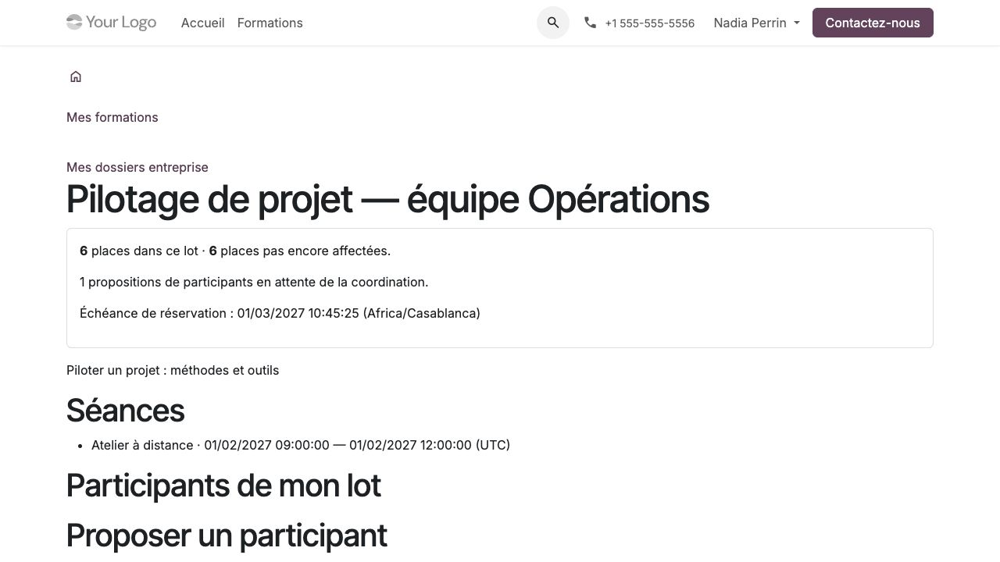

Utiliser le portail entreprise
==============================

**Profil :** représentant d'un client disposant d'un compte portail et d'une
habilitation explicite. Être rattaché au contact d'une entreprise ne suffit pas.

Donner une habilitation au représentant
---------------------------------------

Le coordinateur ouvre **Habilitations du portail entreprise** dans Organisation.
Il choisit le compte existant, la société exploitante, l'entité commerciale
cliente et les lots autorisés, puis confirme. Une habilitation confirmée ne
change plus de périmètre : la révoquer et la remplacer pour modifier les lots.

Le représentant utilise ensuite **Mon compte → Mes formations → Formations de mon entreprise**
(``/my/company-trainings``). Si aucun dossier n'apparaît, faire vérifier compte,
entité, lots et habilitation ; créer un deuxième compte n'est pas la solution.

Consulter son dossier
---------------------

#. Ouvrir le lot concerné depuis **Formations de mon entreprise**.
#. Vérifier quantité, places restant à nommer et échéance de réservation.
#. Consulter les séances, les noms et états des participants de ce lot.
#. Télécharger seulement les PDF explicitement diffusés et encore autorisés.

   Synthèse d'un lot autorisé dans le portail entreprise.

Une session partagée avec d'autres clients ne donne pas accès à leurs personnes.
Les réponses, scores, positionnements, adaptations personnelles et échanges
de tutorat ne sont pas affichés. Les PDF commerciaux conservent aussi leurs
habilitations nominatives distinctes. Une révocation ferme les anciens liens
et téléchargements, mais ne rappelle pas une copie déjà téléchargée.

Proposer des participants
-------------------------

#. Ouvrir le lot et le formulaire de proposition.
#. Renseigner nom et courriel avec soin, puis transmettre.
#. Vérifier la présence de la nomination et son statut de traitement.
#. Contacter la coordination pour corriger une proposition déjà envoyée.

Une nomination transmise conserve son nom, son courriel et son auteur. Elle
ne crée ni contact, ni compte, ni inscription. La coordination contrôle la
proposition, crée ou réutilise les identités adéquates dans le circuit existant,
puis rattache éventuellement l'inscription au même lot. Une répétition du
même envoi retrouve la proposition, sans admission supplémentaire.

Approuver une version intra
---------------------------

#. Ouvrir la version client proposée dans le dossier.
#. Lire objectifs, cas métiers, consignes et PDF de cette version exacte.
#. Enregistrer l'accord si le contenu convient ; sinon demander une correction
   à la coordination avant l'accord.
#. Pour une nouvelle version, lire de nouveau le contenu et enregistrer un nouvel accord.

La coordination confirme ensuite le contenu. L'accord ne modifie pas le
programme standard et ne vaut pas accord sur toutes les versions futures.
Le contenu précédemment confirmé reste applicable jusqu'à confirmation du suivant.

Recevoir des documents et synthèses
-----------------------------------

Les documents de formation délivrés se consultent dans **Mes documents de
formation** lorsqu'ils ont été partagés explicitement avec les contacts autorisés.
Les synthèses de mise en pratique sont rédigées et publiées séparément dans
le périmètre convenu : aucune copie automatique des travaux ou retours privés
des salariés ne les alimente. Une nouvelle habilitation ne récupère pas
automatiquement les anciens destinataires.

**À vérifier avec l'organisme :** version approuvée, personnes attendues, séances,
places restantes et documents accessibles. L'inscription et l'activation
pédagogique restent des décisions distinctes de la proposition et de l'accord.
