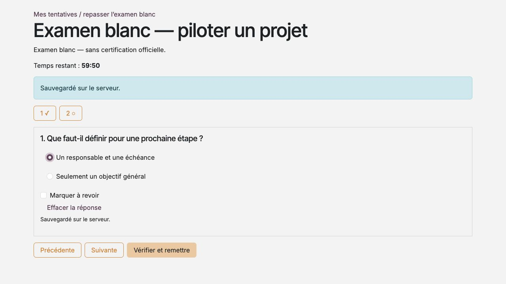
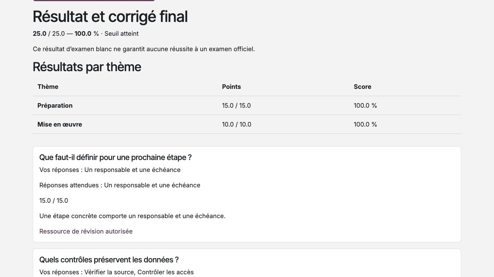

Configurer et passer les examens blancs
=======================================

**Profils :** coordinateur pour la préparation, participant pour la passation.
L'intégration Surveys doit être installée. L'examen blanc est un entraînement,
distinct d'une certification officielle ou d'une attestation de formation.

Préparer une version d'examen
-----------------------------

#. Depuis la version de programme, créer l'examen avec l'éditeur Sondages.
#. Définir les questions QCU/QCM fixes, leur ordre, les réponses correctes et
   les points de chaque question. Ne pas utiliser de tirage aléatoire.
#. Renseigner durée, seuil, thème principal ou section, explications et
   éventuelles ressources PDF de révision autorisées.
#. Vérifier toutes les questions puis publier pour figer la version.
#. Affecter cette version à une activité d'évaluation du même programme et
   renseigner le seuil attendu pour sa progression.

La coordination utilise aussi le rôle natif Sondages nécessaire à l'éditeur.
Après publication, créer une nouvelle version pour changer questions, barème
ou durée. Les tentatives anciennes conservent leur contenu et résultat.

Commencer et répondre
---------------------

#. Dans **Mes formations**, ouvrir l'activité puis lire les instructions.
#. Confirmer le départ : le serveur fixe le début et l'échéance de la tentative.
#. Répondre avec les choix proposés. Utiliser **Précédente**, **Suivante** ou
   la palette de questions pour naviguer.
#. Utiliser **Marquer à revoir** pour signaler une question à reprendre et
   **Effacer la réponse** pour supprimer un choix.
#. Contrôler les messages de sauvegarde, puis **Vérifier et remettre**.
#. Relire le récapitulatif et confirmer la remise finale.

   Navigation et sauvegarde des réponses pendant une tentative.

Chaque modification reçue, y compris un effacement, est sauvegardée. Le
chronomètre n'est pas mis en pause par la navigation ou le rechargement.
Rouvrir une tentative en cours reprend la même tentative ; cela n'en crée pas une seconde.

.. important::
   En cas de coupure, les changements non reçus restent seulement dans la page
   ouverte. Utiliser la reprise proposée avant l'échéance et attendre la
   confirmation. Un rechargement perd les changements non reçus. À l'expiration,
   seules les réponses arrivées au serveur à temps sont retenues.

Comprendre le score et la correction
------------------------------------

Pour chaque question, l'ensemble exact des réponses attendues donne les points
de la question ; une réponse partielle, inexacte ou absente donne zéro.
Il n'y a ni crédit partiel ni pénalité. Le seuil s'applique au score avant
l'arrondi d'affichage. Exemple : 18 points sur 24 donnent 75 % ; un seuil de
75 % est atteint.

Après remise ou expiration, le résultat présente score, points, détail par
thème et correction finale. Une section sans question évaluée reste non évaluée.
Les ressources de révision sont proposées seulement si leur accès est encore
autorisé. Une révision motivée du résultat ajoute un historique sans effacer l'initial.

   Lire les points par thème et l'explication après remise.

Repasser et consulter son historique
------------------------------------

Les tentatives sont illimitées, y compris après 100 %, tant que les droits
autorisent un nouveau départ. Chaque nouvelle tentative possède sa durée
complète et son résultat propre. **Mes tentatives d'examen blanc** conserve les
résultats terminés après expiration ordinaire des accès ; suspension et
révocation bloquent leur consultation.

Une tentative commencée avec des droits valides peut aller jusqu'à son
échéance si la période pédagogique expire entre-temps. Cette expiration interdit
un nouveau départ. Une suspension ou révocation bloque immédiatement aussi
une tentative en cours. Le meilleur résultat terminé, avec ses révisions,
peut servir au critère de progression de l'activité ; aucune attestation,
certification ou notification de réussite n'est créée automatiquement.
