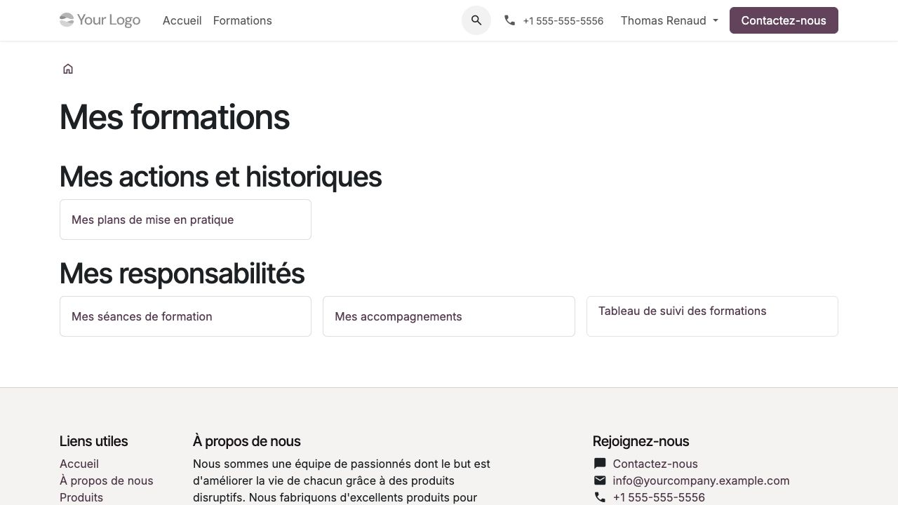

Travailler comme formateur, tuteur ou évaluateur
================================================

Un intervenant utilise son compte Odoo personnel. Un formateur externe peut
travailler depuis le portail ; il n'a pas besoin d'être transformé en utilisateur
interne pour consulter ses missions autorisées.

Préparer une séance
-------------------

#. Ouvrir l'espace formateur depuis **Mon compte**.
#. Consulter les séances affectées à venir ; utiliser les entrées des séances
   passées ou de la liste complète si nécessaire.
#. Vérifier programme, dates, fuseau, modalité, salle et lien distant.
#. Consulter les participants confirmés, la synthèse de positionnement et
   les seules consignes utiles à l'animation.
#. Télécharger les supports communs de la réalisation et préparer l'animation.

Une réaffectation retire l'accès aux anciennes séances et ressources.
Les aménagements confidentiels ne deviennent pas intégralement visibles parce
que la personne est formateur. Pour une erreur d'horaire ou de mission,
prévenir la coordination au lieu de consulter un autre compte.

   Le portail affiche les responsabilités effectivement affectées au formateur.

Contrôler les présences
-----------------------

Depuis une séance affectée, ouvrir **Contrôler les présences** et suivre
:doc:`presences`. Les décisions se font par demi-journée écoulée. Une
déclaration participant ne compte pas encore comme durée validée.
Le formateur ne peut valider sa propre présence ni une déclaration dont il
est l'auteur. Une anomalie se motive et garde son historique.

Accompagner les travaux
-----------------------

#. Ouvrir **Mes accompagnements** avec sa mission de tuteur.
#. Choisir le participant et l'activité affectés ; lire la dernière remise.
#. Lire les fichiers autorisés et répondre dans l'échange privé prévu.
#. Pour une validation simple, appliquer le critère annoncé par l'activité.
#. Pour un projet avec grille, évaluer sous la dernière réponse : un niveau par
   critère, un retour motivé, puis révision demandée ou acceptation.
#. Vérifier le message de confirmation et la progression courante.

La seule affectation à une séance ne donne pas tous les droits de tutorat.
Un tuteur individuel remplace celui de la réalisation. Pour un projet pratique,
la mission courante, l'affectation et l'habilitation **Projet pratique** sont
toutes requises. L'auto-évaluation de son propre projet est refusée, même avec
plusieurs rôles. Une ancienne page doit être rechargée si une nouvelle remise a été déposée.

Évaluer des acquis
------------------

Une évaluation de formation exige une habilitation distincte, accordée par
la qualité pour une finalité, une réalisation et une période. Le rôle de
formateur, coordinateur ou superviseur ne suffit pas à lui seul.
Lire :doc:`evaluations` avant de valider un résultat ou une source observée.

Les validations pédagogiques et qualité sont différentes : l'évaluateur conclut
sur les acquis ; le responsable qualité du dossier contrôle la preuve qui
permettra éventuellement de délivrer une attestation.

Tutorat réservé et suivi après formation
----------------------------------------

Consulter ses réservations dans le portail. Les engagements extérieurs doivent
être déclarés dans les indisponibilités auprès de la coordination ; le module
ne synchronise pas automatiquement un agenda externe. Ne pas déplacer
silencieusement un créneau réservé : la coordination annule puis propose un remplacement.

Pour les plans après formation, le tuteur actuellement affecté peut ajouter
un retour après réalisation de l'action et avant clôture, si cette prestation
est incluse. Les retours successifs sont conservés. La clôture normale et
l'expiration des supports ne suivent pas les mêmes règles que le retrait
explicite des accès ; voir :doc:`apres-formation`.
