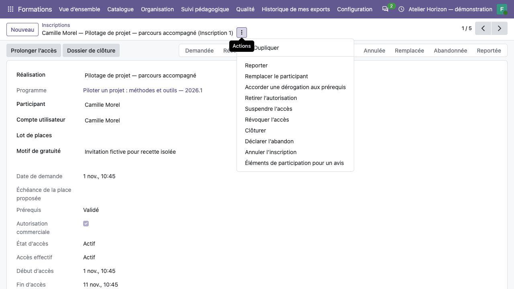

Organiser les sessions et les inscriptions
==========================================

**Profil :** coordinateur dans ses sociétés autorisées. L'utilisation d'une
source commerciale nécessite aussi les droits natifs Ventes correspondants.

Créer une formation organisée
-----------------------------

#. Ouvrir :menuselection:`Formations --> Organisation --> Formations organisées`.
#. Choisir la version validée du programme, la société exploitante et le responsable.
#. Choisir une réalisation datée ou autonome. Pour une session, renseigner début,
   fin et fuseau de référence ; ne pas créer de dates fictives pour l'autonome.
#. Définir capacité, seuil d'ouverture et politique d'accès : période fixe ou
   durée à partir de la première activation explicite.
#. Documenter le besoin commun, puis préparer le planning et les moyens.

La capacité nulle signifie une capacité illimitée. Après création de lots ou
d'inscriptions, les références et paramètres protégés ne doivent pas être
réécrits librement. Une modification des dates ne déplace pas automatiquement
les séances ou périodes d'accès.

Planifier les séances et préparer les personnes
-----------------------------------------------

#. Depuis la réalisation ou **Séances**, ajouter un créneau ou une série :
   formateur, dates et heures locales, modalité, salle/lieu et lien distant.
#. Pour le présentiel, définir lieu/salle ; pour le distanciel, un lien HTTPS ;
   pour le mixte, les deux. Vérifier les dates dans l'intervalle de la réalisation.
#. Contrôler les indisponibilités de formateurs et de salles. Les horaires
   jointifs sont admis ; un chevauchement exige une dérogation motivée.
#. Renseigner sur les inscriptions le positionnement utile et la synthèse à
   transmettre au formateur. Garder les aménagements sensibles dans leur dossier privé.
#. Confirmer la réalisation pour contrôler et réserver les ressources.
#. Vérifier les destinataires et déclencher explicitement la diffusion des convocations.

Confirmer n'envoie pas automatiquement les convocations. Une réalisation datée
exige un planning complet ; une confirmation sous le seuil nécessite un motif.
Une heure inexistante au changement d'heure est refusée ; une heure ambiguë
demande de choisir son occurrence. Lire le fuseau affiché avant de confirmer.

Les aménagements ont un référent et, si nécessaire, un suppléant. Qualité et
commercial n'en deviennent pas lecteurs automatiquement. Transmettre seulement
la consigne utile au formateur, sans détails dans le chatter ou les convocations.

Réserver et confirmer des places
--------------------------------

#. Dans **Lots de places**, créer le lot client de la réalisation : quantité,
   référence et échéance de réservation.
#. Vérifier l'engagement commercial correspondant. La confirmation du lot exige
   la commande confirmée et un effectif contractuel disponible.
#. Créer les inscriptions nominatives dans **Inscriptions**, liées au lot ou
   justifiées par une gratuité motivée.
#. Vérifier l'identité exacte, les prérequis ou une dérogation motivée, puis confirmer.
#. Pour une liste d'attente, proposer explicitement une place et sa nouvelle
   échéance ; aucune promotion n'est automatique.

Un lot de dix places avec sept noms occupe dix places. Une réservation expirée
ne compte plus à l'heure serveur, même si son état affiché n'a pas encore été
matérialisé par **Constater l'expiration**. Les personnes seulement en demande
ou attente ne consomment pas de capacité. Une personne ne peut pas avoir deux
inscriptions non terminales dans la même réalisation.

Autoriser et ouvrir l'accès pédagogique
---------------------------------------

#. Associer à l'inscription le compte personnel actif du participant.
#. Valider les prérequis ou enregistrer une dérogation motivée et confirmer l'inscription.
#. Enregistrer l'autorisation commerciale motivée ; elle peut couvrir un paiement différé.
#. Vérifier la période d'accès et les éventuelles étapes préalables du parcours.
#. Ouvrir explicitement l'accès, puis faire vérifier **Mes formations** par le participant.

Un accès programmé devient effectif à la date prévue, avec contrôle à chaque
requête. Une reprise après suspension ne redémarre pas la durée initiale.
Une prolongation exige un motif et conserve les anciennes dates.

   Les opérations secondaires se trouvent dans le menu d'actions de l'inscription.

Suspendre, annuler, reporter ou remplacer
-----------------------------------------

**Suspendre** bloque temporairement l'accès. **Révoquer** est définitif pour
l'inscription. Retirer l'autorisation commerciale ou désactiver le compte
bloque également l'accès effectif. L'annulation conserve le dossier et révoque l'accès.

Pour un report ou remplacement, ouvrir le menu **⋮** de l'inscription, choisir
l'action, sélectionner la cible et saisir le motif. Le report conserve la
personne sur une nouvelle réalisation ; le remplacement crée une nouvelle
inscription pour une autre personne dans le même lot. La cible est une nouvelle
demande : prérequis, autorisation, période et résultats ne sont pas transférés automatiquement.

La place libérée par une personne revient d'abord au lot. Pour libérer la
capacité globale et l'engagement commercial, réduire explicitement le lot ou
l'annuler après traitement des inscriptions. Une réduction sous les noms encore
occupants est refusée. Aucun de ces gestes ne crée de facture, d'avoir ou de remboursement.

Publier une session et garantir son départ
------------------------------------------

Sur la réalisation, **Session : état et disponibilité** est un diagnostic de
la situation. Dans l'onglet **Session publique**, décider séparément de
l'ouverture commerciale, de la publication et du départ garanti motivé.
La session doit être future, datée et liée à un programme actuellement public.

La complétude prime sur ouverte/confirmée. Une confirmation interne ou un seuil
atteint ne donne pas un départ garanti. Changer dates ou fuseau retire
l'engagement et la publication jusqu'à nouvelle décision. Une session annulée,
commencée, fermée commercialement ou privée n'est plus projetée au public.
Voir :doc:`catalogue-public` pour le parcours d'alerte volontaire.
