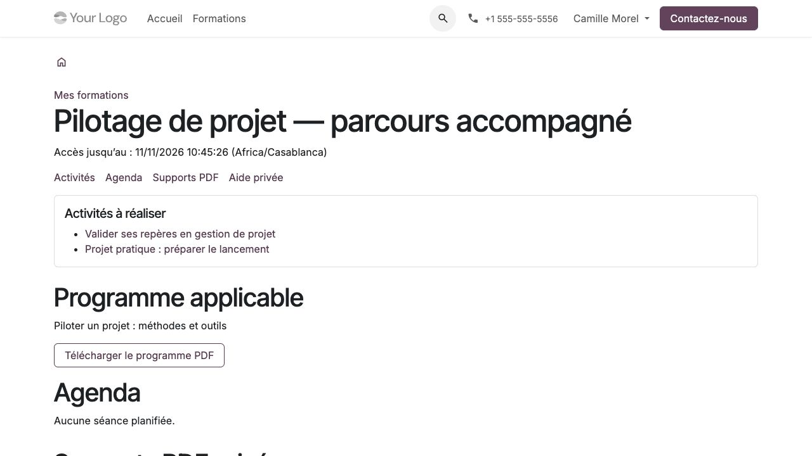

Suivre sa formation
===================

**Profil :** participant avec son compte personnel associé à une inscription.
Le compte utilisé doit être celui que la coordination a rattaché à l'inscription.

Ouvrir son espace
-----------------

#. Se connecter, ouvrir **Mon compte**, puis **Mes formations**.
#. Choisir son inscription. Vérifier le programme applicable et la date de fin d'accès.
#. Lire les activités à réaliser, les préalables et les consignes.
#. Consulter l'agenda pour le lieu, le lien distant et les horaires affichés.
#. Ouvrir **Supports PDF** et télécharger les fichiers autorisés.

   La fiche rassemble les ressources utiles à une inscription.

Une formation autonome n'affiche pas de séance fictive. Une inscription peut
être confirmée sans accès encore ouvert : autorisation, dates et prérequis
du parcours doivent aussi être satisfaits. Demander à la coordination de
vérifier ces éléments si la formation attendue manque.

Réaliser les activités et déposer un travail
--------------------------------------------

#. Ouvrir une activité et lire le critère de réalisation annoncé.
#. Effectuer le travail demandé. Une consultation, une remise, une validation
   du tuteur ou un seuil d'évaluation correspondent à des critères différents.
#. Pour une remise, renseigner le texte et/ou choisir le fichier demandé,
   dans la limite de **20 Mo**.
#. Envoyer et vérifier le message de confirmation ainsi que le travail affiché.
#. Relire le retour du tuteur. Si une révision est demandée, effectuer une
   nouvelle remise ; les versions précédentes restent conservées.

Télécharger un PDF n'enregistre pas automatiquement une progression, une
présence ou un acquis. Un projet avec grille peut revenir à l'état incomplet
après nouvelle remise ou demande de révision ; seule l'acceptation requise
le rend à nouveau complet. Voir :doc:`pedagogie`.

En cas de fichier refusé, lire l'erreur, conserver le texte affiché et choisir
un fichier conforme avant de renvoyer. Vérifier la confirmation avant de quitter
la page. Les fichiers et échanges individuels restent réservés aux personnes habilitées.

Utiliser l'aide et le tutorat
-----------------------------

Depuis la formation, utiliser l'aide privée pour une question à son tuteur.
Éviter de placer des données de tiers ou des informations sensibles inutiles
dans les travaux. L'employeur ne reçoit pas automatiquement ces échanges.

Si une prestation de réservation est incluse, ouvrir **Réservations de tutorat** :

#. Vérifier le quota disponible, la durée et le fuseau des créneaux proposés.
#. Lire les conditions d'annulation et de restitution d'unité.
#. Choisir un créneau et confirmer une seule fois, puis contrôler la réservation.
#. Pour annuler, le faire avant le début ; après le début, contacter la coordination.

Chaque confirmation consomme une unité, quelle que soit la durée. Une
annulation libère la place avant le début ; elle restitue l'unité seulement
selon la règle annoncée. Si la coordination annule le créneau, les unités des
réservations encore confirmées sont restituées. Une réservation ne vaut pas présence.

Autres actions et historiques
-----------------------------

Depuis l'espace personnel, retrouver :

* **Mes parcours** : étapes, progression et conditions d'accès ;
* **Mes présences** : déclarations par demi-journée, détaillées dans :doc:`presences` ;
* les examens blancs et **Mes tentatives**, détaillés dans :doc:`examens` ;
* **Mes évaluations de formation**, détaillées dans :doc:`evaluations` ;
* plans de mise en pratique, demandes de publication et réclamations,
  détaillés dans :doc:`apres-formation` et :doc:`qualite` ;
* **Mes documents de formation** pour les documents délivrés et autorisés.

L'expiration des supports n'efface pas les résultats historiques et ne suit
pas nécessairement les mêmes règles que les attestations, plans après formation
ou réclamations. Une suspension ou révocation peut bloquer aussi ces accès
selon leur règle propre. Un ancien lien ne contourne pas un retrait de droit.
