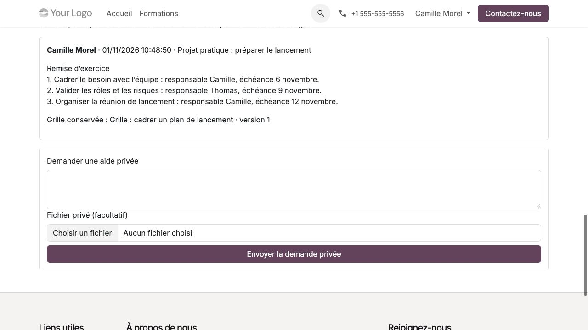

Préparer les supports, activités et projets
===========================================

**Profil :** coordinateur ; les actions de correction restent réservées aux
tuteurs et évaluateurs remplissant les conditions de mission et d'habilitation.

Préparer des supports privés
----------------------------

#. Depuis la version de programme, ajouter les PDF communs et leurs libellés.
#. Préparer la réalisation : elle reprend les références communes applicables,
   sans recopier les fichiers. Ajouter les compléments propres au groupe.
#. Vérifier titres, ordre, contenu, accessibilité et version avant diffusion.
#. Ouvrir ou programmer les accès des inscriptions selon le circuit d'organisation.
#. Pour remplacer un support déjà diffusé, créer une nouvelle version liée ;
   ne pas écraser le fichier initial. Retirer un support si sa diffusion doit cesser.

L'ouverture, y compris programmée, gèle les versions affectées. La disponibilité
à un formateur affecté sur une réalisation confirmée les gèle aussi. Une nouvelle
version commune ne remplace pas automatiquement les références déjà préparées :
le coordinateur choisit son application aux réalisations concernées.

.. important::
   Conservation et accès sont distincts. Un fichier peut être conservé sans
   être encore téléchargeable par l'apprenant. Ne pas déposer les supports,
   travaux ou échanges privés dans le chatter général de la réalisation.

Définir les activités et leurs critères
---------------------------------------

#. Sur la réalisation, ouvrir **Activités et accompagnement**.
#. Définir l'intitulé, la consigne, le caractère obligatoire ou facultatif et les préalables.
#. Choisir le critère : déclaration prévue par l'activité, remise, validation
   du tuteur ou évaluation avec seuil selon le besoin.
#. Affecter un tuteur existant sur la réalisation ou sur une inscription.
   Le tuteur individuel remplace celui de la réalisation.
#. Renseigner les échéances et relances utiles ; vérifier les conditions dans le portail.

Les préalables doivent rester cohérents et sans cycle. La progression n'est
pas une mesure automatique d'acquisition : elle applique le critère de chaque
activité. Une activité ayant du travail conserve sa définition ; une nouvelle
exigence ou version d'examen se prépare sur une nouvelle activité.

   Travail déposé par le participant : l'envoi conserve la remise, sans valider
   automatiquement le critère d'acceptation du tuteur.

Concevoir un projet pratique avec grille
----------------------------------------

#. Dans **Configuration → Grilles de projets pratiques**, créer les critères.
#. Décrire pour chaque critère les quatre niveaux : non acquis, en cours
   d'acquisition, acquis, maîtrisé ; publier la grille pour la figer.
#. Sur une activité, choisir cette grille, le critère **Validation du tuteur**,
   le livrable attendu, la référence de prestation et une conservation approuvée.
#. Affecter le tuteur et sa mission pédagogique. Faire attribuer par la qualité
   l'habilitation **Projet pratique**, pour la réalisation et la période nécessaires.
#. Vérifier le dépôt participant puis le formulaire d'évaluation sous la dernière remise.

L'évaluateur choisit un niveau pour chaque critère, motive son retour et demande
une révision ou accepte. Il n'y a pas de seuil numérique implicite. Une nouvelle
remise ou demande de révision retire la complétion courante ; l'acceptation la
rétablit. Une nouvelle grille se publie en nouvelle version et s'applique à
une nouvelle activité, sans réévaluation automatique du passé.

La coordination suit les paramètres et états de progression ; son rôle seul
ne donne pas accès à tous les travaux et évaluations détaillés. Le projet ne
remplace pas l'évaluation d'acquis notée exigée pour une attestation de réussite.

Suivre les étapes d'un parcours
-------------------------------

Relier les étapes aux inscriptions existantes via **Rattachements aux parcours**.
Une même inscription peut servir à plusieurs parcours sans multiplier places,
travaux ou progression. Les contraintes de ces parcours se cumulent.

Une étape complète exige des activités obligatoires effectivement complètes.
Une inscription clôturée sans travail ne suffit pas. En ordre obligatoire,
les étapes antérieures doivent être satisfaites ; en ordre conseillé, les
prérequis explicites restent applicables. Une étape déjà complète peut être
réutilisée sans retirer l'accès acquis. Aucun rattachement nouveau ne doit
bloquer silencieusement une inscription déjà active.

Si le rattachement est erroné, le retirer avec motif, puis rattacher la bonne
inscription. Les traces restent conservées ; les dépendances sont réévaluées.
Le participant retrouve la synthèse dans **Mes parcours**.

**Vérification avant ouverture :** programme applicable, supports lisibles,
consignes, critères, tuteur, habilitation d'évaluation, préalables et période.
Ne pas confondre un contrôle de configuration avec une recette du parcours participant.
