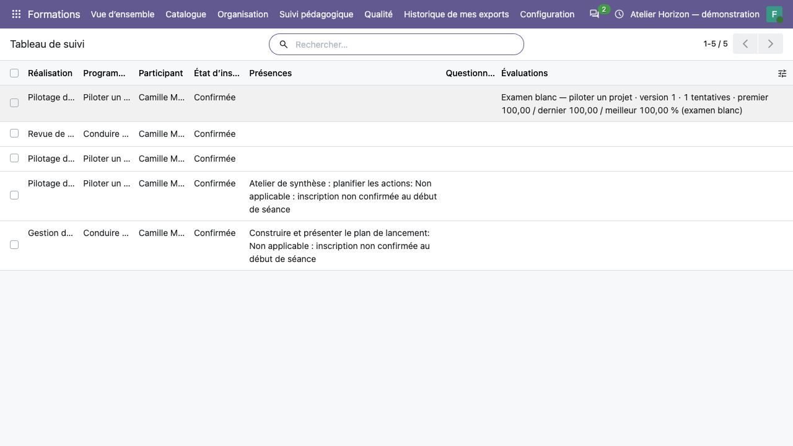

Piloter l'activité et lire les indicateurs
==========================================

**Profils :** coordination, superviseurs affectés, référents autorisés et
formateurs sur leurs missions. Chaque profil conserve son périmètre ;
consulter un indicateur ne donne pas le droit de valider ses sources privées.

Utiliser le tableau de suivi
----------------------------

#. Ouvrir :menuselection:`Formations --> Vue d’ensemble` (**Tableau de suivi**) ou l'entrée de
   suivi correspondant à son profil dans le portail.
#. Choisir réalisation, états, séances et période utiles.
#. Lire la population retenue et la date de situation.
#. Repérer les éléments à terminer : accès, émargements, évaluations, retours,
   preuves ou clôture selon les colonnes proposées.
#. Ouvrir la source autorisée pour effectuer ou demander la correction métier.
#. Exporter seulement le périmètre et les colonnes autorisés si nécessaire.

Le tableau présente une ligne par inscription, y compris les états annulés
ou abandonnés. Il ne diffuse pas les devoirs, échanges privés ou preuves
sensibles par son seul accès. Un superviseur n'acquiert aucun pouvoir de validation.
Le formateur externe utilise la projection de ses missions affectées.

La date de situation correspond à l'extraction actuelle. La période filtre
les débuts de séances et les échéances d'évaluations/questionnaires : elle
ne reconstruit pas un tableau historique. Les campagnes conservent leurs
agrégats d'origine ; un filtre nominatif ne recalcule pas leurs réponses.

   Une ligne par inscription ; la lecture du tableau ne donne pas les droits
   de correction ou d'accès aux réponses privées.

Interpréter les chiffres
------------------------

.. list-table::
   :header-rows: 1
   :widths: 25 75

   * - Indicateur
     - Lecture correcte
   * - Présence
     - Minutes validées / minutes planifiées applicables. Déclaration, papier et contrôle sont distincts ; l'absence vaut zéro.
   * - Couverture de présence
     - Suivi des couples inscription/séance. Sans séance, l'asynchrone est non applicable ; un planning daté manquant reste un manque.
   * - Acquis
     - Validations au seuil / évaluations notées validées, par définition et version ; compléter avec la couverture validées / affectées applicables.
   * - Examens blancs
     - Premier, dernier, meilleur score et nombre de tentatives par version ; distincts du taux d'acquis.
   * - Remplissage
     - Distinguer places confirmées, réservations et capacité ; ne pas additionner lot et noms.
   * - Complétion
     - Critères requis des activités pour les parcours arrivés à échéance. Critères ou échéances manquants restent visibles.
   * - Retours anonymes
     - Agrégat figé après clôture à partir de trois réponses recevables, sans état nominatif.
   * - Montants
     - Par devise et selon le périmètre annoncé. Ne pas additionner directement des devises différentes.

Un résultat absent n'est pas zéro. Un dénominateur nul signifie **non calculable**.
Par exemple, 10 validations au seuil sur 12 évaluations notées validées donnent
83,33 %, avec une couverture de 12 sur 20 affectations si 20 sont applicables.
Ces deux mesures répondent à des questions différentes.

Les données financières optionnelles gardent leurs périmètres : ventes affectées,
factures liées moins avoirs et paiements clients natifs de la société sur la
période. Ces paiements ne sont pas automatiquement ventilés par réalisation.
La marge reste différée lorsque les coûts directs et taux nécessaires manquent.

Notifications et erreurs d'envoi
--------------------------------

Le suivi consolide des journaux de notifications : inscription, convocation,
évaluation, rappels ou attestation disponible selon les fonctions utilisées.
Les messages sont individuels et génériques ; les courriels en file conservent
leurs erreurs visibles. Relire la source et le destinataire avant une reprise.

Rejouer une même notification réutilise son envoi prévu ; ne pas créer des
dossiers supplémentaires pour tenter de forcer un courriel. Les droits du
destinataire et son adresse sont revérifiés au transport. Un retrait de droit
peut donc empêcher un envoi déjà mis en file. Un envoi déjà engagé ne peut pas
être rappelé.

Exports et traçabilité
----------------------

L'export du tableau porte sur ses colonnes, sans traverser les données privées
des sources. Il conserve un manifeste de périmètre autorisé. **Historique de mes exports** permet de consulter les traces accessibles à l'utilisateur.
Une affectation retirée ferme aussi les anciens liens et exports soumis aux
droits actuels. Traiter les fichiers déjà téléchargés selon les règles de
conservation de l'organisme.
