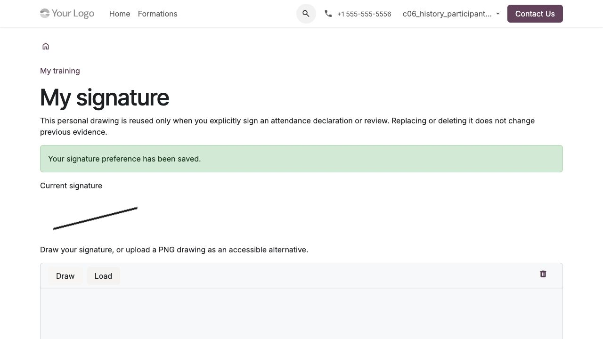
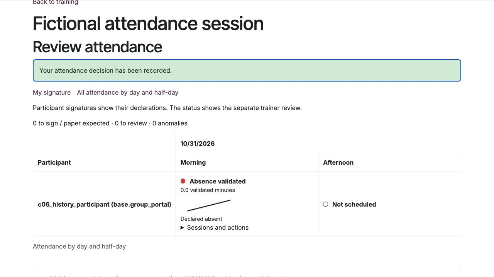

Déclarer et contrôler les présences
===================================

L'émargement se fait **par demi-journée**, à partir des séances prévues.
Une déclaration électronique et sa validation par le formateur sont deux
étapes distinctes. Le papier reste possible selon le mode de collecte configuré.

Préparer la collecte
--------------------

Le coordinateur règle sur la séance le mode papier, électronique ou mixte
et le texte de confirmation. Vérifier participants, horaires et durée du planning
avant la collecte : une présence validée retient cette durée prévue, une absence zéro.
L'asynchrone reste suivi par ses activités, sans création de séances fictives.

Enregistrer sa signature personnelle
-------------------------------------

#. Depuis **Mes formations**, ouvrir **Ma signature** ; ce lien est aussi
   disponible dans le contrôle des présences du formateur.
#. Dessiner sa signature ou charger un dessin **PNG** comme alternative accessible.
#. Cocher l'accord personnel puis enregistrer.

Chaque personne utilise sa propre signature. Elle est réutilisée seulement après
une confirmation explicite pour chaque déclaration ou contrôle. Enregistrer le
dessin ne signe aucune demi-journée automatiquement.

Remplacer ou supprimer le dessin ne modifie pas les preuves déjà signées.
Recharger les formulaires ouverts avant ce changement. Les anciennes présences
et pièces papier ne reçoivent aucune signature inventée lors de la mise à jour.

   Ma signature ; capture en anglais sur un compte de test fictif.

Lire le tableau des présences
-----------------------------

Le participant voit une ligne par jour et deux colonnes **matin / après-midi**.
Dans le suivi d'une réalisation, le tableau collectif présente les participants
par ligne et les demi-journées par date. Ses filtres jour, semaine ou tous les
jours limitent aussi les compteurs affichés. Le contrôle par séance conserve
ses actions et un lien vers le tableau collectif.

.. list-table:: Pastilles et statut
   :class: attendance-legend
   :header-rows: 1
   :widths: 20 80

   * - Pastille
     - Signification
   * - Verte
     - Présence validée par le formateur.
   * - Orange
     - Déclaration en attente, validation partielle x/y, ou présence mixte après contrôle de toutes les séances. Lire le libellé et le détail.
   * - Rouge
     - Absence validée, déclaration invalidée ou anomalie ; le libellé distingue ces cas.
   * - Grise
     - Demi-journée à venir, à signer ou papier attendu.
   * - Contour vide
     - Aucune séance planifiée.

La signature de l'apprenant apparaît dès sa déclaration active, avant contrôle
formateur. Elle ne prouve pas la validation finale. La cellule distingue présent
et absent déclarés, et affiche les minutes validées. Développer les séances et
actions pour retrouver horaires, fuseaux et historique. Les anciens intervalles
restent accessibles séparément.

Sur petit écran, faire défiler le tableau horizontalement. Au clavier, placer
le focus sur la zone de défilement puis utiliser les flèches.

Déclarer sa présence comme participant
--------------------------------------

#. Ouvrir **Mes formations**, choisir la formation, puis **Mes présences**.
#. Repérer la demi-journée écoulée, développer ses séances et actions, puis ouvrir la déclaration et vérifier date, horaires et fuseau.
#. Choisir présent ou absent, lire et accepter le texte affiché.
#. Cliquer sur **Signer cette demi-journée**, puis vérifier dessin, statut et date de déclaration.

Les demi-journées futures ou étrangères à la séance sont refusées. La
régularisation après séance reste possible sans délai arbitraire, avant clôture
et avec des accès encore valides ; elle conserve la vraie date de déclaration.
Un accès expiré, suspendu ou révoqué n'est pas rouvert pour cette opération.

Si le planning ou le texte a changé depuis l'ouverture du formulaire, recharger,
relire et confirmer les nouvelles informations. La déclaration ne doit pas
être antidatée. Un lien collectif n'autorise pas à émarger pour une autre personne.

Valider comme formateur
-----------------------

#. Depuis sa séance affectée, ouvrir **Contrôler les présences**.
#. Vérifier la personne, la demi-journée et la déclaration reçue.
#. Choisir la décision et renseigner le commentaire requis en cas d'anomalie.
#. Accepter le texte et cliquer sur **Signer et valider**, puis vérifier les minutes retenues et l'historique.

Le formateur peut constater une absence sans déclaration. Il ne valide pas
sa propre présence ni une déclaration qu'il a lui-même créée. En cas d'erreur
de saisie, les valeurs du formulaire concerné restent disponibles pour correction.

Le superviseur consulte les réalisations affectées sans recevoir d'action de
validation par ce rôle. Le formateur ne contrôle que ses séances affectées.
Constater une absence sans déclaration ne fabrique aucune signature de l'apprenant.

   Absence signée puis contrôlée séparément ; capture en anglais sur des données fictives.

Importer un papier et corriger une erreur
-----------------------------------------

Le coordinateur utilise l'import depuis la séance, indique personne,
demi-journée et provenance, puis dépose le papier signé. Le dépôt attend
le contrôle du formateur. Une feuille collective reste réservée aux
coordinateurs autorisés ; elle n'est pas diffusée aux autres participants ou au client.

Pour une déclaration erronée, le formateur affecté ou un coordinateur habilité
peut l'invalider avec motif. Les minutes deviennent nulles sans suppression
de la déclaration ou des pièces. Une nouvelle déclaration, puis un contrôle
distinct, permettent de régulariser.

Une correction exige motif et justificatif. Elle conserve l'avant/après,
l'auteur et la date réelle. Les sources ne s'additionnent jamais : papier et
électronique pour la même personne et demi-journée ne doublent pas la durée.
La dernière validation, correction ou invalidation fait autorité.

.. admonition:: Exemple

   Une demi-journée comporte 120 minutes prévues. La déclaration seule retient
   zéro minute validée. Après contrôle d'une présence : 120 minutes. Un dépôt
   papier complémentaire ne porte pas le total à 240. Une invalidation le ramène
   à zéro jusqu'à la nouvelle régularisation contrôlée.

La clôture bloque déclaration, validation et invalidation. Une correction
ultérieure ne réécrit jamais les attestations déjà émises : suivre le circuit
de rectification et remplacement dans :doc:`attestations`.
Ce dispositif est une déclaration et un contrôle internes ; il ne revendique
aucune qualification ou certification juridique de la signature.
